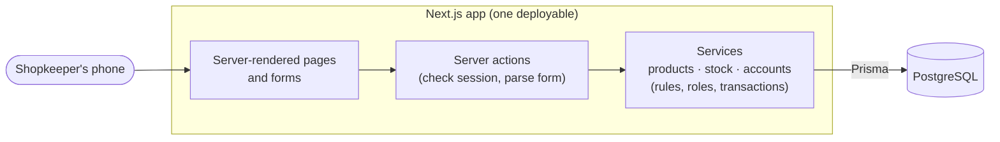
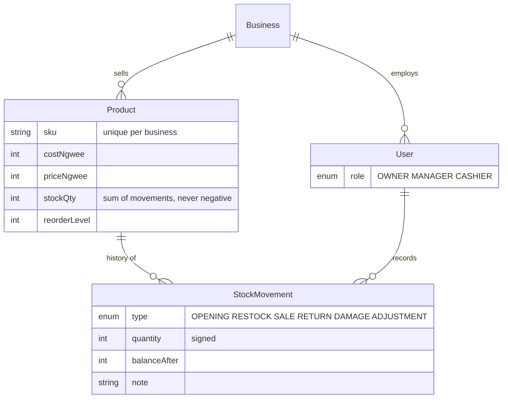

# Kantemba

[](https://github.com/kasondebbuku-spec/zambia-sme-management/actions/workflows/ci.yml)

**Stock, sales, suppliers and profit for small Zambian businesses.** *Kantemba* is the Zambian word for a small market stall or shop, and that's who this is for.

Many small shops in Lusaka, Ndola or Kabwe track stock in an exercise book, if at all. The owner can't tell what's running low until a customer asks for it, can't tell how much money is sitting on the shelves, and can't explain where missing stock went. Enterprise software is too expensive and too complicated. Kantemba is a simple web app that runs on the phone the shopkeeper already has.

> **Status: milestone 1 of 4, foundation and inventory.** Next: point of sale with safe transactions, then customers, suppliers and purchasing, then reports and a live demo. See the [roadmap](#roadmap).

## What it does today

- **Register a business** and become its owner. Roles: owner, manager, cashier.
- **Products** with a code, category, unit (bag, packet, bottle…), cost and selling price, with profit per unit and margin shown.
- **Stock you can trust.** Every change is recorded in a ledger: opening stock, received from a supplier, returned, damaged, or corrected after a count. Each entry has who did it, when, why and the balance after. The current quantity always equals the sum of the ledger.
- **Physical counts.** Enter what's actually on the shelf; the difference is recorded as an adjustment, so missing stock is visible rather than silently overwritten.
- **Running-low alerts** on the dashboard, emptiest first, plus the value of stock at cost and at selling price.
- **Role limits.** Cashiers can see products and stock but can't change prices or adjust stock. This is checked on the server, not just hidden in the page.
- **Built for phones.** No sideways scrolling at 375 px, and forms keep what you typed when something needs fixing.

## Engineering highlights

### Stock can never go negative, even when two cashiers sell at once

The naive way to sell is "read the stock, check it, write the new value". Two cashiers selling the last bag at the same moment both read "1 left", both pass the check, and stock ends at −1.

Kantemba removes stock with **one conditional update**:

```sql
UPDATE "Product" SET "stockQty" = "stockQty" - 3
WHERE id = $1 AND "businessId" = $2 AND "stockQty" >= 3
```

PostgreSQL locks the row for the first sale and re-checks the condition for the second, so only one can succeed. A test fires **10 simultaneous sales at 5 units of stock** and checks that exactly 5 succeed, the other 5 are refused as insufficient stock, stock ends at 0, and the ledger still adds up. See [`src/server/stock.ts`](src/server/stock.ts).

A **physical count** locks the row with `SELECT … FOR UPDATE` before working out the difference, so a sale that lands mid-count isn't overwritten.

### An append-only stock ledger

Stock is never edited directly. Every change is a `StockMovement` with a type, a signed quantity and the balance after it. Each type may only move one way: a restock can't remove stock, and damage can't add it. Tests check after every scenario that `stockQty` equals the sum of the movements.

### Money in whole ngwee

Amounts are stored and calculated as whole ngwee (K1 = 100 ngwee), so `0.1 + 0.2` rounding errors can't happen. Typed amounts are parsed as text, not floats. **`12,50` is refused rather than read as K1,250**: many phones type a comma for the decimal point, and accepting it would price an item a hundred times too high. A test caught this before it shipped.

### Every shop is isolated

Every query is scoped by `businessId` taken from the signed-in user, never from the request. Tests check that one shop can't see, restock or count another shop's products, even with a valid product id.

### Other details

- Sessions are signed JWTs in `httpOnly` cookies; the user is reloaded on every request, so a deactivated account is locked out immediately.
- Unknown email and wrong password give the same answer and take the same time (a dummy bcrypt compare).
- Sign-in attempts are limited per email (10 per 15 minutes).
- After a validation error, forms keep what was typed, except passwords, which are never sent back.

## Architecture



Pages and forms never touch the database directly. **Server actions** check the session and turn form fields into plain values. **Services** in `src/server/` hold every business rule, check the user's role, and run multi-step changes in transactions. The services know nothing about HTTP or forms, which is why they can be tested directly against a real database.

## Data model



Full schema: [`prisma/schema.prisma`](prisma/schema.prisma).

## Testing

```bash
npm test
```

66 tests with Vitest. Most run against a real PostgreSQL database:

- **Stock:** opening stock recorded as a movement; restock, sale, damage and count history with running balances; refusing to oversell with a clear message; **10 simultaneous sales against 5 units**; a sale racing a physical count; movement direction rules; cashiers can't adjust stock; shops can't touch each other's products; dashboard totals and low-stock order
- **Products:** duplicate codes per shop (allowed across shops), selling below cost refused, editing details never changes stock
- **Accounts:** sign-up creates a business and owner together; duplicate email refused without a stray business; case-insensitive sign-in; deactivated accounts refused; attempt limit
- **Money:** formatting, parsing (including `12,50` refused), margin
- **Forms:** typed values echoed back after errors, passwords never echoed

The database tests use `TEST_DATABASE_URL` and are skipped when it isn't set. GitHub Actions runs type checks, lint, all tests against PostgreSQL, and a production build on every push and pull request.

## Run it locally

**Requirements:** Node 20+ and PostgreSQL (or Docker).

```bash
git clone https://github.com/kasondebbuku-spec/zambia-sme-management.git
cd zambia-sme-management
docker compose up -d          # PostgreSQL with kantemba and kantemba_test
cp .env.example .env          # then set SESSION_SECRET and SEED_OWNER_PASSWORD
npm install
npm run db:migrate
npm run db:seed               # demo shop: owner, manager, cashier and 12 products
npm run dev                   # http://localhost:3100
```

Sign in as `owner@kantemba.test`, `manager@kantemba.test` or `cashier@kantemba.test` with your `SEED_OWNER_PASSWORD`, or register a new business at `/signup`.

## Project layout

```
prisma/schema.prisma         data model
prisma/seed.ts               demo shop
src/server/stock.ts          stock ledger, race-safe updates, counts
src/server/products.ts       products, validation, dashboard figures
src/server/accounts.ts       sign-up, password checks, attempt limit
src/server/session.ts        signed session cookie
src/app/actions/             server actions behind each form
src/app/(app)/               signed-in pages: dashboard, products
src/lib/money.ts             ngwee formatting and parsing
tests/                       unit and database tests
```

## Roadmap

- [x] **1. Foundation and inventory:** sign-up and roles, products, stock ledger with race-safe updates, counts, low-stock alerts, tests, CI
- [ ] **2. Point of sale:** a phone-friendly checkout; each sale checks stock, records the sale, reduces stock, records payment (cash or mobile money) and issues a receipt in **one transaction that rolls back completely if any step fails**
- [ ] **3. Customers, suppliers and purchasing:** restocking against supplier orders, customer records and money owed
- [ ] **4. Reports and launch:** daily sales, profit and loss, best sellers, staff accounts, live demo

## Author

**Kasonde Bbuku**, BSc Computer Science (Software Engineering), University of Zambia
GitHub: [@kasondebbuku-spec](https://github.com/kasondebbuku-spec)

Licensed under the [MIT License](LICENSE).
